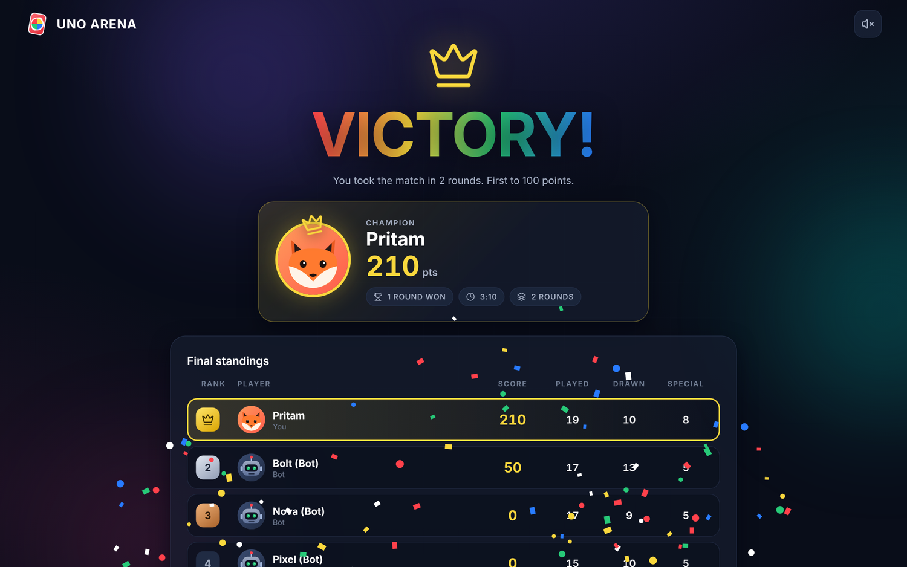

# UNO ARENA

**PLAY TOGETHER. OUTSMART EVERYONE.**

A real-time multiplayer UNO-style card game for up to 4 players, built from the Google Stitch design and master prompt in `design-reference/`. Create a room, share a six-character code, add friends (or bots), and play first-to-500 matches in the browser.

> **Important: this is not the stack the master prompt recommended.**
> The prompt suggested React + Vite + Tailwind + Framer Motion + Lucide + Supabase + Vercel. The build environment had no package installs available, so UNO ARENA is built with **zero dependencies**: a plain Node.js server (`http` + Server-Sent Events) and a vanilla ES-module browser client with no build step. Animations are CSS/Web Animations, icons are inline SVG, and the realtime layer is SSE + JSON `POST`s instead of Supabase Realtime. Everything the prompt asks for in behaviour is implemented; only the technology differs. See [Deployment](#deployment) for what that means in practice.

---

## Run it

Requires **Node 20 or newer**. Nothing to install.

```bash
cd uno-arena
npm start            # or: node server/index.js
# open http://localhost:3000
```

Open the same address in two or more browser windows (or on other devices on your network) to play together. A room link looks like `http://localhost:3000/?room=ABC123`.

### Configuration (environment variables)

| Variable | Default | Meaning |
|---|---|---|
| `PORT` | `3000` | HTTP port |
| `HOST` | `0.0.0.0` | Bind address |
| `TRUST_PROXY` | off | Set to `1` behind a reverse proxy so per-IP limits use `X-Forwarded-For` |
| `UNO_COUNTDOWN_MS` | `3000` | Pre-match countdown |
| `UNO_INTERMISSION_MS` | `7000` | Pause between rounds |
| `UNO_BOT_MIN_MS` / `UNO_BOT_MAX_MS` | `900` / `1900` | Bot "thinking" delay range |
| `UNO_RECONNECT_MS` | `45000` | How long a lobby player may be offline before being removed |
| `UNO_ABANDON_MS` | `120000` | How long an in-game player may be offline before forfeiting |
| `UNO_DISCONNECT_GRACE_MS` | `2000` | Debounce before a dropped connection counts as offline |
| `UNO_ROOM_IDLE_MS` | `600000` | Idle rooms are cleaned up after this long |
| `UNO_TICK_MS` | `250` | Server clock tick |

Other endpoints: `GET /healthz` (liveness) and `GET /api/stats` (live room/player counts).

---

<p align="center">
  
  
</p>
<p align="center">
  
  
  
</p>

More captures (phone layouts, the invite QR, the How to play guide) are in `docs/screenshots/`.

## The four screens

1. **Welcome** – nickname, avatar, Create Room / Join Room, a playable practice table, How to play, Settings and sound toggles, and an Install button when the browser offers one.
2. **Room setup & lobby** – Create/Join tabs with six code boxes; once inside, the code card, four player slots, host settings, bot controls and the Start button with a countdown.
3. **Game arena** – opponent seats, draw and discard piles, active-colour indicator, turn timer rings, fan-shaped hand, UNO button, live log.
4. **Victory** – champion, final standings (rank, avatar, name, score, cards played, cards drawn, special cards), and Play Again / Return to Lobby / Exit Room.

Everything else (wild colour picker, round summary, settings, errors) is a modal or overlay, as the brief required.

## Rules

- Standard 108-card deck, 7 cards each by default. Match colour, number or symbol; Wild cards can always be played.
- **Wild Draw Four** may only be played when your hand has no card of the active colour (enforced by the server; there is no challenge mechanic).
- **Skip, Reverse, Draw Two, Wild, Wild Draw Four** work as normal. With two players, Reverse acts as Skip.
- If you can't play, draw one card. If it is playable you may play **only that card**; otherwise (or by choice) you can pass.
- A wild card flipped as the first discard is reshuffled away; a skip/reverse/draw-two start applies to the first player.
- **UNO:** when you are down to 2 cards the UNO button arms; call it as you play down to 1. If a player reaches 1 card without calling, a **4-second window** opens in which any opponent can press **Catch UNO!**; a successful catch makes the offender draw 2.
- **Scoring:** the round winner scores the cards left in everyone else's hands: number cards face value, Skip/Reverse/Draw Two 20, Wild and Wild Draw Four 50. Rounds repeat until someone reaches the winning score.
- **Turn timer:** if it runs out, the server draws a card (or passes) for you. Two consecutive timeouts put you on autopilot until you make a move.

### Room settings (host only; every one has real server behaviour)

| Setting | Options | Default |
|---|---|---|
| Max players | 2, 3, 4 | **4** |
| Starting cards | 5, 7, 10 | **7** |
| Winning score | 100, 200, 300, 500, 1000 | **500** |
| Turn timer | 15, 20, 30, 45, 60, 90 s | **30 s** |
| Stacking | on/off – +2 on +2, +4 on +4 only | **off** |
| Jump-in | on/off – play an identical coloured card out of turn | **off** |
| Draw until playable | on/off – keep drawing until you can play | **off** |

Settings lock once the match starts. Changing them is host-only and validated on the server.

### Rooms and players

- Room codes are six characters from `ABCDEFGHJKMNPQRSTUVWXYZ23456789` (no look-alikes). Codes are accepted with spaces and in lower case.
- Exact lobby messages: `PLEASE ENTER A ROOM CODE.` · `INVALID ROOM CODE.` · `ROOM NOT FOUND.` · `THIS ROOM IS FULL.` · `THIS MATCH HAS ALREADY STARTED. YOU CAN JOIN WHEN THE HOST OPENS A NEW ROOM.` (the brief only said "show appropriate late-join restriction", so that wording is mine).
- Host can change settings, add/remove bots, kick players and start the match (needs 2+ players). The host crown moves to a connected human automatically if the host leaves.
- **Bots** are added by the host in the lobby. The same bot brain plays for a disconnected player ("autopilot") so a dropped connection never stalls the table.
- **Reconnection:** your session is kept in the browser tab; refreshing or losing connection restores your seat and hand. Opponent hands are never sent to your browser.
- When the match ends the host can **Play Again** (new match, same room) or **Return to Lobby**; anyone can **Exit Room**.

## Client features

### Look and feel

- **Metal cards (the default).** Every card is a bevelled steel plate: a chrome frame, an anodised brushed-metal face and a polished chrome oval with the number engraved in colour. Wilds are gunmetal with an enamelled colour wheel, and the backs are metal too. A card that lands on the table throws a few sparks and a glint runs across the plate. **Settings → Card material** switches to the printed **Classic** look at any time, even mid-game.
- **Opening deal.** The deck is riffled, cards are dealt around the table and the starter is flipped, instead of the hand simply appearing.
- **Card moments.** Draw Two / Draw Four, Skip, Reverse, a colour change and UNO each get a short full-table flourish, and a clear **turn cue** (a glow on the table, a chime, vibration on phones that support it, and `● Your turn` in the browser tab title while the tab is in the background).
- **Table themes** (Midnight, Emerald, Crimson, Aurora) and **card backs** (Classic, Gilded, Neon grid, Mono). Themes only recolour the room; the four UNO colours never change, so cards stay readable everywhere.
- **Colour-blind symbols:** every colour also carries its own shape (triangle, circle, square, diamond) on cards, in the colour picker and on the active-colour chip.
- **Practice table** on the welcome screen: tap a glowing card to learn "match the colour, number or symbol" before joining a room. It is local and never touches the server.
- Responsive layouts for desktop, tablet and phone (touch uses tap-to-select, then tap-to-play). **Reduced motion** is respected from the OS setting and can be forced in Settings; it skips dealing, flights, moments and sparks.
- Palette, fonts (Space Grotesk, Sora, Inter) and radii follow the master prompt. Fonts load from Google Fonts with system fallbacks, so the game still works offline.

### Sound and vibration

- Sound and music both start **off**, never autoplay, and have separate volume sliders.
- **Metal cards sound like metal.** A card leaving your hand makes a quick slide through the air, and a clank when it lands on the table (a heavier, longer clang for action and wild cards). Drawing, dealing and shuffling use matching metal slides, ticks and rattles. Classic cards use the paper sounds instead, and switching material switches the sounds with it.
- Everything you hear is **synthesised live in the browser** (oscillators and filtered noise, no audio files), so nothing is downloaded or licensed. The clank is a small physical model of a struck steel plate (a ringing set of inharmonic partials, a hard contact click and a table thump), not a studio recording.
- Vibration on your turn and on big plays, where the browser has the Vibration API (Android Chrome yes, iOS Safari no). It can be switched off in Settings.

### Controls and play aids

- Fan-shaped hand with hover lift, tap/click to select and play, **drag-and-drop** onto the table, and sort by **colour** or **number**.
- **Keyboard:** arrow keys + Enter to play, `D` draw, `P` pass, `U` UNO, `E` open reactions, `R B Y G` in the colour picker.
- **Move hints** (Settings, off by default): marks a good card with a star and suggests a colour after a wild. It only ranks cards the server already allows, and prefers shedding high-value cards and saving wilds.
- **Reactions:** eight preset emotes (GG, Nice!, Wow, Haha, Thanks, Hmm…, On fire, Great play) shown as a bubble beside the sender. The list is fixed, nobody can type free text, the server rate-limits them, and bots occasionally answer or say "gg" after a round. They are available in the arena only.

### Inviting and installing

- **Invite by link or QR code** from the lobby: copy the link, share it from the phone share sheet, or show a scannable QR (**Save QR** downloads it as an image). The QR encoder is written in the project (`public/js/qr.js`), so there is no library or external service. The lobby warns when the address is `localhost`, because other devices can't open that.
- **Installable (PWA):** a manifest, icons and a small service worker let supporting browsers add UNO ARENA to the home screen. Live game traffic (`/api/…`) is never cached, so rooms always reflect the server.

## Architecture

```
server/
  engine.js   Pure, deterministic rules engine (injectable RNG and clock). No I/O.
  rooms.js    RoomManager: rooms, lobby, presence, bots, timers, reactions, per-player views, results.
  index.js    HTTP server: static files, JSON actions, SSE streams, security headers, rate limits.
public/
  index.html, favicon.svg, manifest.webmanifest, sw.js, icons/
  css/        base · cards · themes · metal · extras · screens · arena
  js/         main, store, net, audio, sound/kit, fx, anim, moments, hero-table, hints, emotes,
              themes, settings, guide, haptics, pwa, qr, qr-view, ui, cards, avatars, icons, dom
  js/screens/ welcome · room · arena · results
tests/        engine · rooms · hints · qr · sound (node:test) · simulate.js · check-syntax.js
design-reference/  the original master prompt and four Stitch HTML screens
docs/screenshots/  captures of the finished game (desktop and phone)
```

**Server-authoritative.** The browser only sends intents (`play`, `draw`, `uno`…). The server validates every one, advances the game and pushes each player a *filtered* view over SSE: your own hand in full, opponents as card counts only. Private events (such as the cards you drew) go only to the player they concern.

**One clock.** A single 250 ms server tick drives the pre-match countdown, round intermissions, turn timeouts, bot moves, bot UNO catches, presence and room clean-up.

### HTTP API

| Method & path | Purpose |
|---|---|
| `POST /api/rooms` | Create a room → `{code, playerId, token}` |
| `POST /api/rooms/join` | Join by code |
| `POST /api/rooms/resume` | Restore a session after refresh |
| `POST /api/action` | `settings` `add_bot` `remove_bot` `kick` `start` `leave` `play` `draw` `pass` `uno` `catch` `rematch` `to_lobby` `emote` |
| `GET /api/events?code&pid&token` | SSE stream: `sync`, `update`, `closed`, `kicked` |
| `GET /api/stats` · `GET /healthz` | Counters / liveness |

### Security notes

Session tokens are random and compared in constant time; mutating requests must be JSON with a matching `Origin`; bodies over 10 KB get `413`; per-IP token-bucket rate limits and an SSE connection cap (12 per IP); strict CSP, `nosniff`, `no-referrer` and frame-denial headers; static serving is path-traversal safe; nicknames are validated and rendered as text only. Rooms live in memory – there is no database and no accounts.

## Testing

```bash
npm test             # 67 node:test tests: 42 rules, 7 room/reaction, 9 move-hint, 6 QR, 3 sound
npm run simulate     # boots a real server and plays full matches over HTTP/SSE:
                     #   lobby errors, kick, late join, reconnection, hidden-hand leak check,
                     #   card conservation on every update, rematch, host transfer, rate limiting,
                     #   reactions (allowlist, rate limit, bots answering)
npm run check        # parses every server and client file; verifies client imports resolve
```

- The QR encoder is pinned by golden hashes. During development every generated code was also decoded with OpenCV's QR detector to confirm that real scanners read it.
- The sound test runs the whole kit against a recording stand-in for the Web Audio graph (Node has none): every effect must schedule without errors, and the metal effects and the metal-voice swaps must exist. Loudness and clipping were measured separately in Chromium with an `OfflineAudioContext`: the clank and clang sit at the level of the existing card sound (about -18 and -15 dB RMS) with peaks under 0.9, so they can't clip.
- The browser flow (welcome practice table → create room → add bots → settings → deal → drag-and-drop and tap plays → special cards → UNO → round over → results, on a 1366×768 desktop and an iPhone 13 profile) was driven end to end in headless Chromium: it played whole matches to the results screen with no console errors and no horizontal overflow. Those scripts aren't shipped because they need Playwright, which this project deliberately doesn't depend on.

## Deployment

Because rooms and live SSE connections are held in the server's memory, UNO ARENA needs a **long-running Node process** – Render, Railway, Fly.io, a VPS, or anything that can run `node server/index.js`. It will **not** work on Vercel-style serverless functions, which can't hold connections or shared state between requests. Run **one instance** (rooms aren't shared between instances); set `TRUST_PROXY=1` if a proxy sits in front, and make sure the proxy doesn't buffer `text/event-stream` responses.

To move to the originally suggested Supabase/Vercel stack later, `server/engine.js` is pure and I/O-free, so it can be reused unchanged inside Edge Functions with Realtime replacing the SSE layer and the room store moved to Postgres.

## Where this differs from the Stitch mockups

- **Real data only.** No invented MMR, ranks, friends lists or fake "players online" counts. The online badge appears only when the server reports a real count.
- **4 players maximum**, stacking **off** by default, and only settings that actually do something are displayed.
- Avatars and the logo are local SVG instead of remote images, so nothing breaks offline.
- Late-join wording and the Wild Draw Four rule (hand must lack the active colour, no challenge) were my decisions where the brief was silent.

## Known limits

- In-memory rooms: a server restart ends all games.
- Names and rooms are anonymous; there are no accounts, free-text chat or persistent leaderboards. Reactions are a fixed set and only work inside the arena.
- Touch devices can't drag-and-drop cards (tap to select, then tap again to play).
- All sound and music is synthesised, not recorded. The metal clank is a physical model, so it is a clean steel "tink" rather than a studio sample. It has only been tuned by measurement and by ear in a browser, not on a wide range of speakers.
- Vibration works only where the browser provides the Vibration API (not iOS Safari).
- Installing UNO ARENA as an app doesn't make it playable offline: the game needs the server. Only the shell is cached.
- A QR invite only helps other devices if you opened the game by a network address (such as `http://192.168.x.x:3000`), not `localhost`. The lobby warns about this.
- The desktop table is sized with CSS container-query units (Chrome and Edge 105+, Safari 16+, Firefox 110+). Older browsers fall back to a window-based size.
