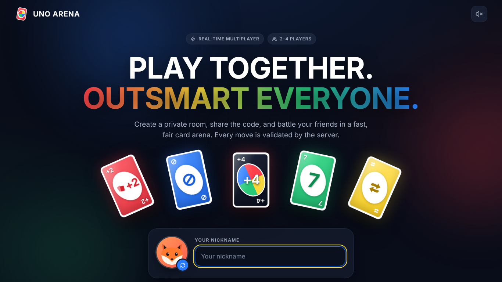
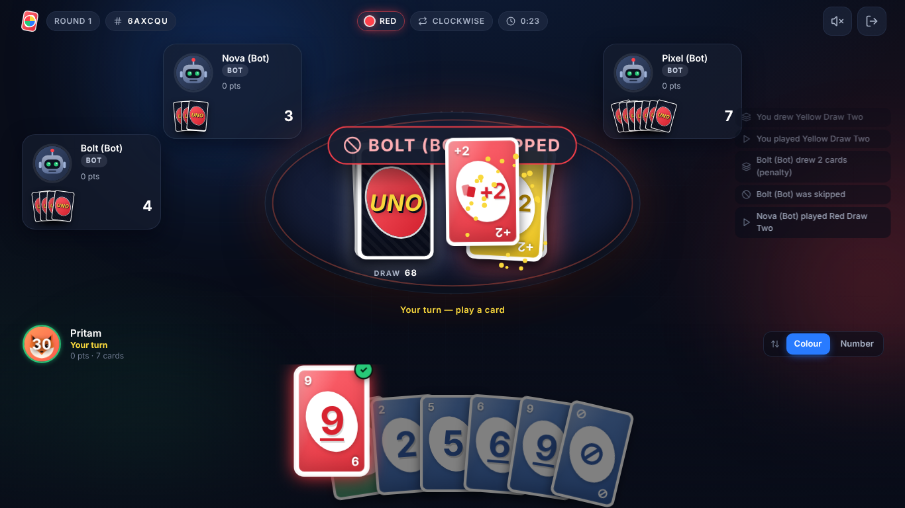
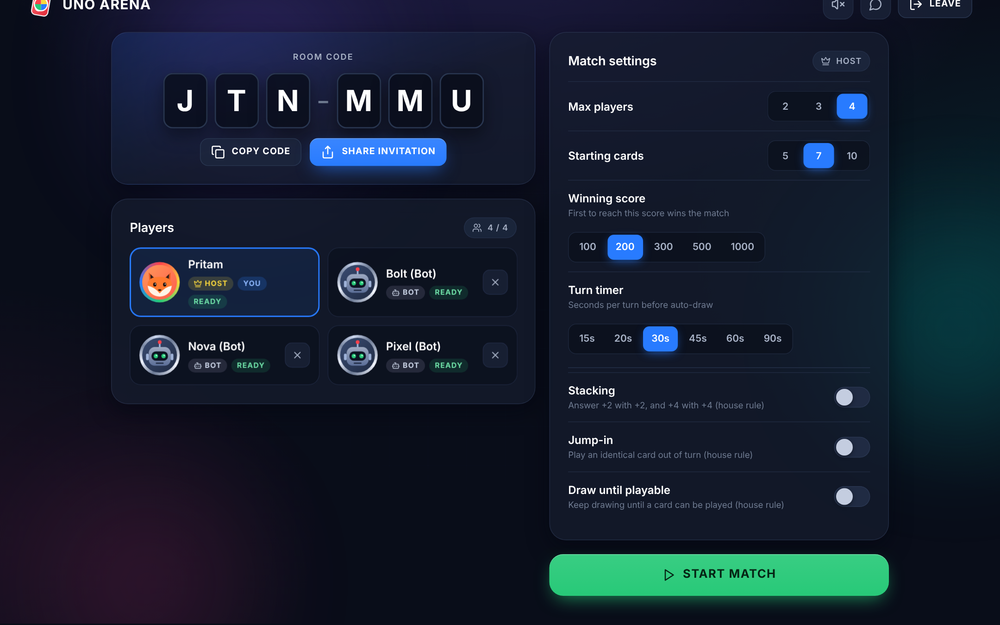
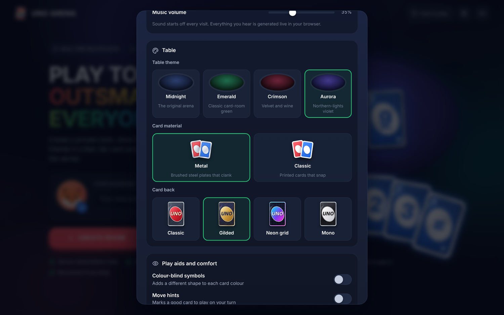
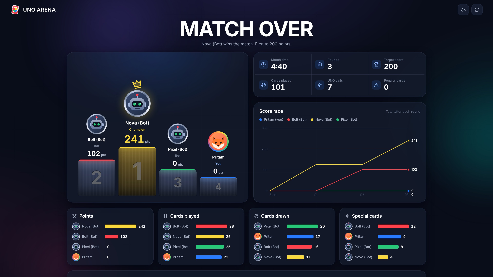

# \# 🎮 UNO ARENA

# 

# \### PLAY TOGETHER. OUTSMART EVERYONE.

# 

# UNO ARENA is a real-time multiplayer UNO-style card game where you can create private rooms, invite friends, play against bots and compete in exciting matches.

# 

# Enjoy a premium metallic card design, smooth animations, live chat, custom themes and a responsive experience across desktop and mobile.

# 

# <p align="center">

# 

# &#x20; \*\*🌐 \[PLAY UNO ARENA ONLINE](https://uno-arena-g0gj.onrender.com/)\*\*

# 

# &#x20; \*Play anytime. Invite your friends. Enjoy the game.\*

# 

# </p>

# 

# \---

# 

# \## 📸 Game Preview

# 

# <p align="center">

# &#x20; 

# &#x20; 

# </p>

# 

# <p align="center">

# &#x20; 

# &#x20; 

# &#x20; 

# </p>

# 

# <p align="center">

# &#x20; 

# </p>

# 

# More desktop, mobile and chat screenshots are available in \[`docs/screenshots/`](docs/screenshots/).

# 

# \---

# 

# \## ✨ Features

# 

# \### 🎯 Multiplayer Gameplay

# \- Create private rooms with unique six-character codes.

# \- Invite friends using room links or QR codes.

# \- Support for up to 4 players.

# \- Add bots and play against AI opponents.

# \- Real-time gameplay and automatic turn management.

# \- Reconnection support if a player disconnects.

# \- Rematches and automatic host transfer.

# 

# \### 🎨 Premium Visual Experience

# \- Metallic card design with polished effects.

# \- Classic and metallic card styles.

# \- Animated cards, table lighting and visual effects.

# \- Custom themes: Midnight, Emerald, Crimson and Aurora.

# \- Custom card backs and avatar frames.

# \- Responsive desktop, tablet and mobile layouts.

# \- 4K display scaling.

# 

# \### 💬 Social Features

# \- Live room and game chat.

# \- Preset player reactions and emotes.

# \- Chat notifications and unread indicators.

# \- Player muting and host-controlled chat settings.

# 

# \### 📱 Mobile \& Personalisation

# \- Installable Progressive Web App (PWA).

# \- QR code invitations.

# \- Sound effects and volume controls.

# \- Mobile vibration support where available.

# \- Reduced-motion accessibility option.

# \- Colour-blind-friendly card symbols.

# 

# \---

# 

# \## 🃏 How to Play

# 

# The objective is to get rid of all your cards and score points by winning rounds.

# 

# 1\. Create a room or join one using a room code.

# 2\. Wait for players or add bots.

# 3\. Start the match when at least two players are ready.

# 4\. Match the top card by colour, number or symbol.

# 5\. Use special cards strategically to challenge opponents.

# 6\. Call UNO when you are down to your final card.

# 7\. Win rounds and reach the target score to win the match.

# 

# \*\*Special cards:\*\* Skip, Reverse, Draw Two, Wild and Wild Draw Four.

# 

# \*\*Game options:\*\* Choose the number of players, starting cards, winning score, turn timer, stacking and jump-in rules.

# 

# The Wild Draw Four card is restricted when you hold a card matching the active colour. With two players, Reverse acts as Skip.

# 

# \---

# 

# \## 🛠️ Technology Stack

# 

# UNO ARENA is built using a lightweight, zero-dependency architecture.

# 

# | Component | Technology |

# |---|---|

# | Frontend | HTML, CSS, JavaScript |

# | Backend | Node.js |

# | Server | Native Node.js HTTP |

# | Real-time communication | Server-Sent Events (SSE) |

# | Game logic | Custom JavaScript engine |

# | Testing | Node.js Test Runner |

# | App installation | Progressive Web App (PWA) |

# 

# The game uses a server-authoritative architecture: the server validates player actions, manages game state and sends each player their permitted game data.

# 

# No external database or account system is currently required.

# 

# \---

# 

# \## 💻 Run Locally

# 

# \### Requirements

# \- Node.js 20 or newer

# \- Git (optional)

# 

# \### Installation

# 

# Clone the repository:

# 

# ```bash

# git clone https://github.com/spritampatel99-max/uno-arena.git

# ```

# 

# Open the project directory:

# 

# ```bash

# cd uno-arena

# ```

# 

# Start the server:

# 

# ```bash

# npm start

# ```

# 

# Open the game in your browser:

# 

# ```text

# http://localhost:3000

# ```

# 

# Open the same local address in multiple browser windows to test multiplayer gameplay.

# 

# \---

# 

# \## 🧪 Testing

# 

# The project includes automated tests for gameplay, rooms, reactions, QR codes, sounds and server behaviour.

# 

# Run the test suite:

# 

# ```bash

# npm test

# ```

# 

# Check JavaScript syntax and imports:

# 

# ```bash

# npm run check

# ```

# 

# Run the multiplayer server simulation:

# 

# ```bash

# npm run simulate

# ```

# 

# \---

# 

# \## 🚀 Deployment

# 

# UNO ARENA is deployed on \*\*Render\*\*.

# 

# \*\*Live Website:\*\* https://uno-arena-g0gj.onrender.com/

# 

# The application requires a continuously running Node.js server because multiplayer rooms and real-time connections are maintained in server memory.

# 

# Supported hosting options include Render, Railway, Fly.io and VPS hosting.

# 

# For the current architecture:

# \- Run only one server instance.

# \- Configure `TRUST\_PROXY=1` when running behind a trusted reverse proxy.

# \- The hosting provider supplies the `PORT` environment variable.

# \- Server restarts close active rooms because room data is stored in memory.

# 

# \---

# 

# \## 📁 Project Structure

# 

# ```text

# uno-arena/

# │

# ├── design-reference/    Original design references

# ├── docs/

# │   └── screenshots/     Game screenshots

# │

# ├── public/

# │   ├── css/             Stylesheets and themes

# │   ├── js/              Frontend JavaScript

# │   ├── icons/           App icons

# │   ├── index.html

# │   ├── manifest.webmanifest

# │   └── sw.js

# │

# ├── server/

# │   ├── engine.js        Game rules and logic

# │   ├── rooms.js         Multiplayer room management

# │   └── index.js         HTTP server and API

# │

# ├── tests/               Automated tests

# ├── package.json

# └── README.md

# ```

# 

# \---

# 

# \## ⚠️ Current Limitations

# 

# \- Rooms and player sessions are stored in memory.

# \- Restarting the server ends active games.

# \- No user accounts or persistent leaderboards.

# \- Only one server instance is supported by the current architecture.

# \- Online gameplay requires an active internet connection.

# 

# \---

# 

# \## 🎮 Start Playing!

# 

# Gather your friends, create a room and see who can outsmart everyone.

# 

# <p align="center">

# 

# &#x20; \*\*\[▶ PLAY UNO ARENA](https://uno-arena-g0gj.onrender.com/)\*\*

# 

# &#x20; Built with creativity, JavaScript and a love for multiplayer games.

# 

# </p>


